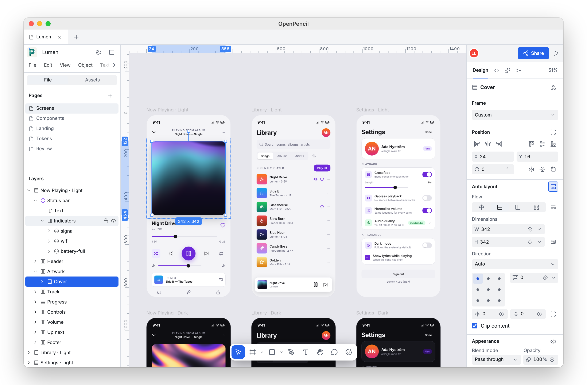

# OpenPencil

[](LICENSE)
[](https://www.npmjs.com/package/@open-pencil/cli)
[](https://discord.gg/4wXc9fuZfm)
[](https://github.com/open-pencil/open-pencil/discussions)

Open-source design editor. Opens `.fig` and `.pen` design files, includes built-in AI, and ships as a programmable toolkit with a headless Vue SDK for building custom editors.

> **Status:** Active development. Usable today, with some rough edges as features evolve.

**[Try it online →](https://app.openpencil.dev/demo)** · [Download](https://github.com/open-pencil/open-pencil/releases/latest) · [Documentation](https://openpencil.dev) · [Roadmap](https://openpencil.dev/development/roadmap) · [llms.txt](https://openpencil.dev/llms.txt)



## Installation

**macOS (Homebrew):**

```sh
brew install --cask openpencil
```

Or download from the [releases page](https://github.com/open-pencil/open-pencil/releases/latest), or [use the web app](https://app.openpencil.dev) — no install needed.

Requires macOS 13 or later with current Safari updates, Windows 10 or later, or Linux with WebKitGTK 2.40+; the web app needs Chrome 111, Edge 111, Firefox 128, or Safari 16.4 or later. See [system requirements](https://openpencil.dev/getting-started#system-requirements).

Official builds send one anonymous ping a day and share usage stats only if you agree. The [privacy page](https://openpencil.dev/overview/privacy) lists every field, everything else the app sends, and how to turn it off.

## What it does

- **Opens `.fig` and `.pen` files** — read and write native Figma files, open supported Pencil documents from the app or OS file browser, copy & paste nodes between apps
- **AI builds designs** — describe what you want in chat, 100+ tools create and modify nodes. Bring your own key for the major providers or any compatible endpoint
- **Fully programmable** — headless CLI, XPath queries, Figma Plugin API plus an `openpencil` API via `eval`, MCP server for AI agents, and desktop agent integrations for Claude Code, Codex, Gemini CLI, and Pi
- **Lint, convert, and extract tokens** — inspect documents, lint naming/layout/accessibility, convert between supported formats, analyze colors/typography/spacing/clusters, and extract design tokens
- **Components and variants** — create reusable components, group variants into component sets, insert local assets as instances, and switch variants from the inspector
- **Working controls** — give a component a Reka UI behaviour (switch, slider, tabs, text field, …) and preview it live over the canvas, with real inputs, focus, and keyboard
- **Image vectorization** — convert image layers into editable vector layers with Recraft or fal.ai
- **Design-to-code export** — export selections as JSX/Tailwind, generate token outputs, and map designs into component-oriented code workflows
- **Vue SDK for custom editors** — headless components and composables for embedding OpenPencil into other apps or building workflow-specific editing surfaces. [Read the SDK docs →](https://openpencil.dev/programmable/sdk/)
- **Real-time collaboration** — share a peer-to-peer room over WebRTC with no server or account, or edit Cloud documents together. Cursors, presence, follow mode, voice calls
- **Optional Cloud** — keep documents on your team's own [OpenPencil Cloud](https://openpencil.dev/user-guide/openpencil-cloud) server, or on the hosted service once it opens, and share them by invitation
- **Auto layout & CSS Grid** — flex and grid layout via Yoga WASM, with gap, padding, alignment, track sizing
- **~15 MB desktop app** — Tauri v2 for macOS, Windows, Linux. Also runs in the browser as a PWA

## CLI

```sh
npm install -g @open-pencil/cli
# or: bun add -g @open-pencil/cli
```

### Inspect design files

Browse node trees, search by name or type, dig into properties — all without opening the editor:

```sh
openpencil tree design.fig
openpencil find design.pen --type TEXT
openpencil node design.fig --id 1:23
openpencil info design.fig
```

```
[0] [page] "Getting started" (0:46566)
  [0] [section] "" (0:46567)
    [0] [frame] "Body" (0:46568)
      [0] [frame] "Introduction" (0:46569)
        [0] [frame] "Introduction Card" (0:46570)
          [0] [frame] "Guidance" (0:46571)
```

### Query with XPath

Find nodes by type, attributes, and structure:

```sh
openpencil query design.fig "//FRAME[@width < 300]"  # Frames under 300px
openpencil query design.fig "//SECTION//TEXT"        # Text inside sections
```

### Export, convert, and import

Render to PNG, JPG, WEBP, SVG, PDF, PPTX, HTML, JSX, Storybook stories, or `.fig`, convert between document formats, and turn HTML/CSS into editable layers:

```sh
openpencil export design.fig                  # PNG
openpencil export design.fig -f jpg -s 2      # JPG at 2x
openpencil export design.fig -f tailwind-jsx  # Tailwind JSX
openpencil export design.fig -f storybook     # Storybook stories per component
openpencil convert design.pen design.fig      # Between document formats
openpencil import card.html --css card.css    # HTML/CSS → editable .fig
```

### Lint and analyze

Catch naming, layout, and accessibility issues, and audit a design system's real palette, type scale, spacing, and repeated components:

```sh
openpencil lint design.fig --preset strict  # Naming, layout, accessibility
openpencil analyze colors design.fig        # Also typography, spacing, clusters
openpencil variables design.fig             # Variables and collections
```

```
#1d1b20  ██████████████████████████████ 17155×
#49454f  ██████████████████████████████ 9814×
#ffffff  ██████████████████████████████ 8620×
#6750a4  ██████████████████████████████ 3967×
```

### Script with the Figma Plugin API

`eval` runs JavaScript against the document with Figma's Plugin API; `-w` writes the result back:

```sh
openpencil eval design.fig -c "figma.currentPage.selection.forEach(n => n.opacity = 0.5)" -w
```

### Control the running app

Omit the file argument and the CLI works on the document open in the editor:

```sh
openpencil tree                                 # Inspect the live document
openpencil documents list                       # Also open, new, save, close, activate
openpencil tool call get_selection              # Run any MCP tool
openpencil undo                                 # Undo the newest automation change
openpencil settings set appearance.theme light  # Change editor settings
```

Every command supports `--json`. See the [CLI reference](https://openpencil.dev/reference/cli) for all commands and options.

## AI & MCP

### Built-in chat

Press <kbd>⌘</kbd><kbd>J</kbd> (<kbd>Ctrl</kbd><kbd>J</kbd> on Windows and Linux) to open the AI assistant. It has 100+ tools that can create shapes, set fills and strokes, manage auto-layout, work with components and variables, run boolean operations, analyze design tokens, and export assets. Bring your own API key for OpenRouter, Anthropic, OpenAI, Google AI, DeepSeek, Z.ai, MiniMax, or compatible endpoints. No backend, no account.

Not every provider works in the browser, and not every model streams tool calls correctly. See [BYOK provider & model compatibility](https://openpencil.dev/programmable/byok-provider-compatibility) for measured results — contributions welcome.

### Coding agents (desktop)

Use Claude Code, Codex, Gemini CLI, or Pi as the design agent in the chat panel. It runs with your own subscription and reaches the canvas through the editor's MCP server. Requires the desktop app.

Install the agent's ACP program and `@open-pencil/mcp`, then open **Settings → AI & agents → Run guided setup**. It checks that both are installed, signs the agent in, and confirms a session reaches OpenPencil's tools. Pi runs through the `@open-pencil/harness` companion, which guided setup installs with one click. See [Coding agents](https://openpencil.dev/programmable/coding-agents) for each agent's install command.

### MCP server

Connect Claude Code, Cursor, Windsurf, or any MCP client to inspect, modify, and export design documents headlessly. [Full docs →](https://openpencil.dev/programmable/mcp-server)

**Stdio** (Claude Code, Cursor, Windsurf):

```sh
npm install -g @open-pencil/mcp
claude mcp add --scope user open-pencil -- openpencil-mcp
```

For other MCP clients:

```json
{
  "mcpServers": {
    "open-pencil": {
      "command": "openpencil-mcp"
    }
  }
}
```

**HTTP** (scripts, CI):

```sh
openpencil-mcp-http   # Unix socket on macOS/Linux + http://127.0.0.1:7600/mcp
```

Set `OPENPENCIL_MCP_ROOT` to limit file access to one directory; it defaults to the current working directory.

### [AI agent skill](skills/open-pencil/SKILL.md)

Teach your AI coding agent to use OpenPencil — inspect designs, export assets, analyze tokens, modify .fig files:

```sh
npx skills add open-pencil/open-pencil
```

Works with Claude Code, Cursor, Windsurf, Codex, and any agent that supports [skills](https://skills.sh).

For documentation-aware agents, the docs site publishes [llms.txt](https://openpencil.dev/llms.txt), [llms-full.txt](https://openpencil.dev/llms-full.txt), and per-page Markdown files generated from the VitePress docs.

## Collaboration

Share a link to co-edit in real time. No server, no account — peers connect directly via WebRTC.

1. Click the share button in the top-right panel
2. Share the generated link (`app.openpencil.dev/rooms/<room-id>`)
3. Collaborators see your cursor, selection, and edits in real time
4. Click a peer's avatar to follow their viewport
5. Click the headphones beside the avatars to start or join the room's voice call

## Why

Figma is a closed platform that resists programmatic access: its MCP server is read-only, and automation outside the Plugin API breaks when it ships a point release. Your design files are in a proprietary binary format that only its software can fully read.

OpenPencil is the alternative: open source (MIT), local-first, reads .fig files natively, and every operation is scriptable.

See the [roadmap](https://openpencil.dev/development/roadmap) for product direction and current Figma compatibility gaps.

## Community

- **[Discord](https://discord.gg/4wXc9fuZfm)** — chat, quick questions, and showing a problem live
- **[GitHub Discussions](https://github.com/open-pencil/open-pencil/discussions)** — [Q&A](https://github.com/open-pencil/open-pencil/discussions/categories/q-a) for help, [Ideas](https://github.com/open-pencil/open-pencil/discussions/categories/ideas) for feature proposals, [Show and tell](https://github.com/open-pencil/open-pencil/discussions/categories/show-and-tell) for what you built; maintainers post [Announcements](https://github.com/open-pencil/open-pencil/discussions/categories/announcements) there
- **[Issues](https://github.com/open-pencil/open-pencil/issues)** — reproducible bugs; report security problems through a [private advisory](https://github.com/open-pencil/open-pencil/security/advisories/new)

## Contributing

```sh
bun install
bun run dev:portless  # Web editor at https://open-pencil.localhost
bun run tauri dev     # Desktop app (requires Rust)
```

[CONTRIBUTING.md](CONTRIBUTING.md) covers setup, quality gates, pull requests, and commits. [AGENTS.md](AGENTS.md) maps the repository and links the guide inside each package. Desktop builds need [Rust](https://rustup.rs/) and the [Tauri v2 prerequisites](https://v2.tauri.app/start/prerequisites/); run `bun run tauri build`.

### Tech stack

| Layer         | Tech                                                                              |
| ------------- | --------------------------------------------------------------------------------- |
| Rendering     | Skia (CanvasKit WASM)                                                             |
| Layout        | Yoga WASM (flex + grid via [fork](https://github.com/open-pencil/yoga/tree/grid)) |
| UI            | Vue 3, Reka UI, Tailwind CSS 4                                                    |
| File format   | Kiwi binary + Zstd + ZIP                                                          |
| Collaboration | Trystero (WebRTC P2P) + Yjs (CRDT)                                                |
| Desktop       | Tauri v2                                                                          |
| AI/MCP        | Vercel AI SDK (multi-provider BYOK), MCP SDK, Hono                                |

## Acknowledgments

Thanks to [@sld0Ant](https://github.com/sld0Ant) (Anton Soldatov), who pushed for OpenPencil to be published, has backed and promoted it since, and built the first version of the [documentation site](https://openpencil.dev).

Thanks to everyone who has [contributed](https://github.com/open-pencil/open-pencil/graphs/contributors) code, translations, bug reports, and feedback.

Thanks to [Anthropic](https://www.anthropic.com) for supporting the project through its open source program, and to [CodeRabbit](https://www.coderabbit.ai) for reviewing every pull request for free.

## License

OpenPencil is licensed under the [MIT License](./LICENSE), except OpenPencil Cloud, which is licensed under the [Apache License 2.0](./LICENSES/Apache-2.0.txt). [`REUSE.toml`](./REUSE.toml) lists the exact paths.

Copyright (c) 2026 Danila Poyarkov and OpenPencil contributors.
