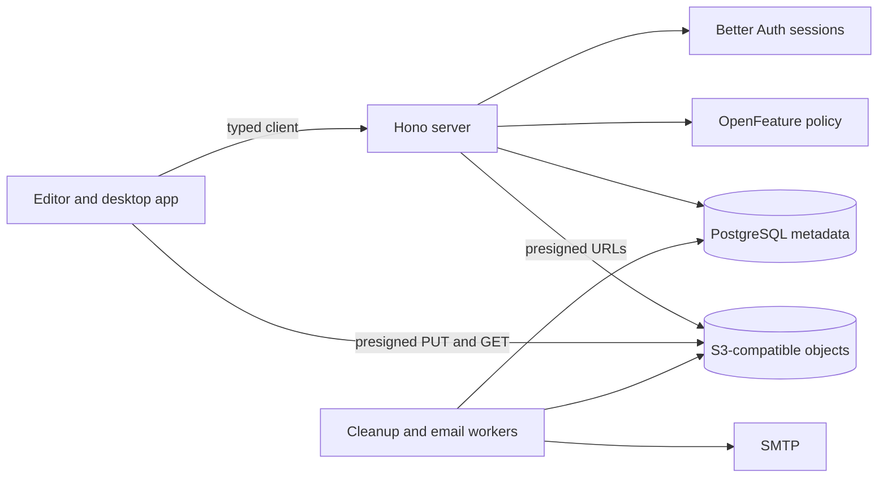
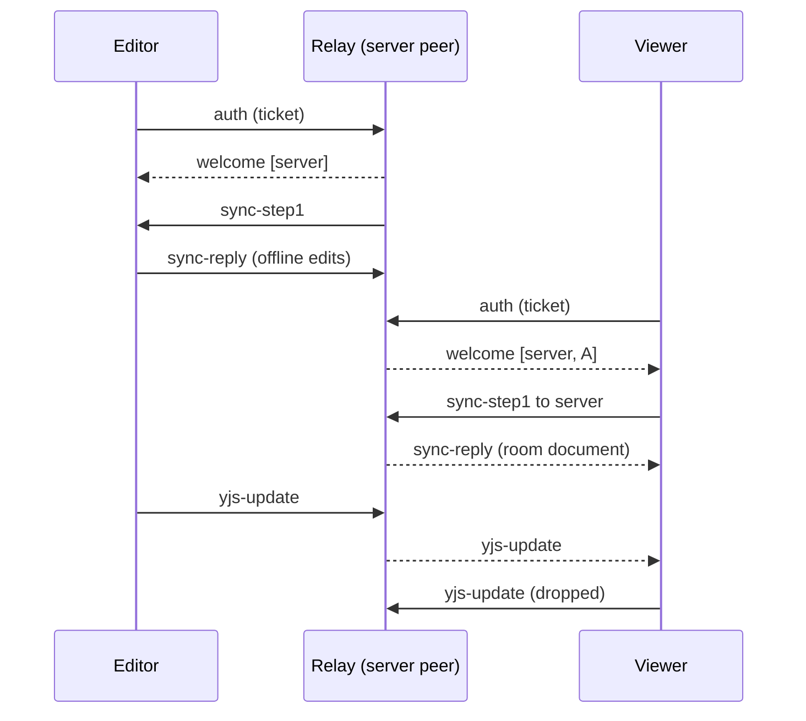

# Cloud Architecture

OpenPencil Cloud is an optional, self-hostable backend for storing, sharing, and collaborating on
documents. The editor stays local-first: opening, editing, and saving local files never needs this
package, a network connection, or an account.

`@open-pencil/cloud` holds the network contracts, a typed client, a runtime-neutral Hono server, and
two runtimes that wire PostgreSQL, S3-compatible storage, email, and background work into it: a Node
process, and Cloudflare Workers.

## Package boundaries

| Subpath                           | Contents                                                                   |
| --------------------------------- | -------------------------------------------------------------------------- |
| `@open-pencil/cloud/contract`     | Valibot schemas and types shared by every side of the network              |
| `@open-pencil/cloud/client`       | Discovery, authentication, device authorization, and the typed Hono client |
| `@open-pencil/cloud/email`        | Vue Email rendering for transactional mail                                 |
| `@open-pencil/cloud/server`       | Hono routes and services; every dependency is injected                     |
| `@open-pencil/cloud/runtime/node` | PostgreSQL, S3, SMTP, the HTTP listener, workers, and operator commands    |

The Cloudflare runtime, `src/runtime/cloudflare`, isn't a subpath: Wrangler bundles it from
a deployment folder, type-checked against the Workers types by its own `tsconfig.json`.
`deploy/cloudflare` is the folder self-hosters copy; the official deployments are filled-in copies
under `deploy/openpencil/<target>`, which the Deploy Cloud workflow deploys with the secrets of the
`cloud-<target>` GitHub environment. A new target needs its folder, that environment, and an option
in the workflow.

The server never imports `pg`, opens a listener, runs migrations, or starts timers; runtimes do.
Browser code imports only `contract` and `client`, so it never pulls in server dependencies.

## Documents and revisions

PostgreSQL stores workspaces, membership, documents, revisions, uploads, sharing, and quota state.
Object storage stores immutable `.fig` revisions; a document points at its current revision, and every
revision has its own object key.

- Uploads go straight from the client to object storage through presigned single or multipart PUTs.
  The server verifies a SHA-256 digest before committing; ETags only complete multipart uploads.
- Each upload names the revision it was based on, so a stale base is rejected instead of silently
  overwriting a newer revision. The client then chooses: take the Cloud revision, keep both, or
  replace it.
- Deleting a document is immediate for users; the cleanup worker removes revisions and objects once
  the retention period passes.
- Images are stored once per workspace, keyed by the SHA-256 the object store verifies, and a stored
  revision leaves them out of its file: it lists the images it uses under the names the file gives
  them, and a download returns a link for each. Before a save the client asks which of its images
  the workspace lacks and uploads only those, each as an upload of its own kind with its own
  reservation, committed together in one request; asking renews the images the workspace holds.
  An image under a name Cloud does not accept stays inside the file. A save that names an image
  the workspace does not hold is refused. Keying by the verified checksum, with names kept per
  revision, means bytes uploaded under the wrong name can only reach the revision that named them.
- Restoring or duplicating a version gives the new revision the same images. Compaction releases an
  image no kept revision uses once a day has passed since a save last asked for it: its bytes return
  to the workspace's usage and the object sweep deletes its file.

### Version history

Every save is a revision, but the history a person sees is its versions: checkpoints the server
keeps on its own, and versions someone named (`document_version`, one per revision).

- When a save lands and the newest version is half an hour old, the server keeps the revision that
  save replaces as a checkpoint, so each stretch of editing and the state every session ended on stay
  in the history. A document's first save is always one.
- Naming the current state, or naming any version, makes it a named version; deleting its info turns
  it back into a checkpoint. Viewers see the history; editors name, restore, and duplicate.
- Restoring keeps the replaced state as a checkpoint, adds a revision that points at the restored
  version's stored file, and advances the collaboration epoch, so the live room starts over on it.
  Duplicating makes a new document in the same workspace from the same file. Neither uploads
  anything or uses more storage.
- A restore ends the document's rooms on the relay with close code `4410`, and the relay turns away
  tickets for an earlier epoch. A tab told so, or handed a ticket for another room, drops its queued
  uploads, shows the restored file it downloads, and joins the new room; a saver never overwrites a
  revision once its room has moved on.
- In the editor, File → Show version history makes the document read-only and lists its versions in
  the right sidebar, as Figma does. Choosing a version shows it in a read-only editor of its own in
  place of the document, whose room keeps syncing underneath; Save to version history (⌥⌘S) names
  the document once it is uploaded. A tab that does not save asks the room's saver on the `upload`
  channel, after its own edits, and names it when the saver answers that its upload finished. When
  a version is named, renamed, or turned back into an autosave, or a save adds a checkpoint, the
  server sends `versions` to the document's rooms and every open history loads it again; peers
  cannot send it.
- A document's address is `/documents/:id` on its server, with `?version=…` for a version; the
  editor keeps the address bar on the active tab's document and the version it shows when the
  document is on the server serving the editor, and a version's Copy link builds the address on the
  document's server. The address carries no secret: opening it signs in to the server at that
  address, one the app already knows or the official one, and the server's access rules decide. Fetching a version returns the version with its download, so
  a link can show it without paging the history.
- The cleanup worker compacts saves that are neither current nor a version once they are a day old,
  a batch at a time, and returns the bytes of files nothing else uses to the workspace's usage. A
  freed file's row stays until the object store deletes it, so a failed delete is retried. With
  the `revision_history` entitlement off, a workspace keeps 30 days of versions, as on a free plan.

## Authentication and authorization

Better Auth owns users, sessions, social sign-in, email and password, passkeys, TOTP, and recovery
codes. OpenPencil owns workspace and document authorization. For clients that cannot host a browser
redirect, such as the desktop app, the server supports the OAuth device authorization flow and
accepts the resulting bearer token.

Access to a document comes from ownership, workspace membership, a direct grant, or a capability
link, and the strongest source wins. Revoking one source leaves access inherited from another.
Documents granted to someone outside their own workspaces are listed for them separately, so a
client can show what was shared with them.

Workspace administrators invite people by email with a role. Workspace invitations use the same
`/invitations/:id` link as document invitations: preview and accept look for a workspace
invitation first and fall back to a document one, so email, the desktop handoff, and the editor's
invitation dialog serve both. A workspace with members always keeps an administrator.

Database rows use UUIDs. Capability secrets and invitation tokens are random hex; only their SHA-256
digests are stored, and they travel in URL fragments so they never reach access logs or `Referer`
headers. Invitation continuations through OAuth are single-use compact JWE.

Every sign-in is recorded in `sign_in` with the session it made and how it was made. A Better
Auth plugin, `accountActivity` in `src/server/auth/activity.ts`, reads the session an endpoint
issued from the hook context's `newSession`, which two-step sign-in leaves empty until the second
step, and the method from the endpoint, as Better Auth's own `lastLoginMethod` does: a password,
Google or Apple, a passkey, a second step, an email link, or the desktop app's device code. A person's Sessions page lists their live sessions with
that method and the browser the server reads from the user agent, and their latest sign-ins. A
sign-in from an address the account was never signed in from is emailed to its owner, except the
account's first. Adding or removing an authenticator app or a passkey is emailed too, and so is
an administrator resetting them.

A new email address is confirmed from that address through Better Auth's change-email link, and
the old address is told which address is taking over. An approved enrollment follows the account
to its new address, so the approval stays with the account.

Collaboration tickets are signed, epoch-scoped JWTs naming the principal and permission. Rotating a
capability secret keeps the current epoch; revoking access advances it so old tickets stop working.

## Live collaboration

Collaboration in the editor runs Yjs sync and awareness over a `CollabRoomTransport`. Local
documents use Trystero peer-to-peer; Cloud documents use the Cloud relay, a WebSocket endpoint at
`/api/collaboration/relay` on the API origin. Both carry the same room messages, so the editor has
one sync implementation.

The relay joins every room as a peer named `server`. It holds the room's Yjs document, saved in
PostgreSQL by document and collaboration epoch, so a newcomer gets the document even when nobody
else is online. Tickets are short-lived signed JWTs; the client presents a fresh one before the
current one expires, and the relay closes a socket whose ticket lapsed or changed identity.

A socket message carries at most 256 KiB of a frame, under the deployment's per-message limit,
which may not be lower. A larger frame, such as a big paste, the first editor's copy of a large
document, or a newcomer's sync reply, travels as fragments in a row that the receiver joins again.
The relay joins an editor's fragments up to 256 MiB and holds viewers and peers not yet admitted to
one message, so only an editor can make it buffer more. A peer the relay turns away for good, for
a ticket, a full room, or a frame past those limits, leaves the room: the document's status says it
is not editing live and offers to rejoin, a viewer stays read-only, and an editor saves on its own,
since a tab that was not the room's saver had its edits counted as saved by the room.

Each runtime decides where rooms live. The Node process holds every room in one relay. On
Cloudflare, a Durable Object per document holds that document's rooms, and the Worker routes a
socket to it by the document named in the ticket's relay URL (`?document=`), since the ticket itself
arrives only after the upgrade; the object refuses tickets for any other document.

A Cloud room names its images instead of carrying them: an editor stores an image it adds in the
document's workspace and puts only its SHA-256 in the room's `imageRefs` map, and every peer loads
the images it lacks through links the server signs for anyone who may view the document, or for a
guest through its share link. A guest or a viewer cannot store images, so the ones it adds travel as
bytes until an editor in the room stores them and swaps them for references; a store that fails
leaves the bytes in the room. The room's state, which the relay saves, therefore holds no image
bytes once an editor has stored them. A peer that cannot load an image asks again later, waiting
longer each time up to a minute, while the room still names it.

The relay enforces what the ticket allows: a viewer's document updates and sync replies never leave
it, and presence updates are rewritten so others see the ticket's name and a `cloud` field with the
verified identity and permission. A peer cannot claim presence clients another peer owns. Voice is
not carried over the relay yet; the transport reports no media.

## Enrollment and administration

Enrollment is `open`, `approval`, or `closed`. In approval mode a verified identity creates a
pending request that a deployment administrator approves or rejects; approval can be revoked later.
Deployment administrators are separate from workspace administrators, and startup never grants
either role: the first operator is approved and promoted through the `admin` command.

The console's lists are tables the server pages, searches, and filters: each admin list endpoint
takes `search`, `filter`, `limit`, and `offset` and answers with its rows, the `total` matching, and
how many match the search under each filter (`src/admin/list.ts`). A list declares its filters once, as conditions on its table; one query counts them all with `count(*) filter (where …)`, and the page uses the same condition. People lists accounts in sign-up
order, searched by name or email and filtered to administrators, suspended accounts, or accounts
without two-step sign-in; access requests are searched by name or email in each status; email by
recipient and delivery; activity by the names of who acted and whom it was about, and by what it
was about. In the portal, `usePortalList` (`src/app/cloud-portal/list.ts`) holds a list's search,
filter, and page and builds its TanStack Table; `PortalTable` draws the toolbar, the shared
`AppDataTable`, and the pages, and each list only defines its columns, which render their cells with the components in `src/components/cloud-portal/table/`. A row has at most one inline
action, such as Approve; the rest are in its “…” menu. A person's page shows how they sign in, their workspaces, sessions, and recent
sign-ins. Administrators make and remove administrators, sign people out everywhere, suspend
with a reason the activity log keeps, and reset a locked-out person's two-step sign-in, which
removes their authenticator app, recovery codes, and passkeys, and take down a person's picture.
Every action asks once more.

Account pictures live in `user_picture`, one per account, and `user.image` holds the address the
server serves them from, `/api/pictures/:userId/:version`, where the version is the start of the
picture's SHA-256: a new picture is a new address. Responses are cached for one day, so a
picture an administrator removes may stay visible until the cache expires. The
page crops and shrinks a picture to a 256-pixel JPEG; the server accepts PNG or JPEG of at most
256 KB and 1024 pixels a side, reading the type and size from the bytes. A Google picture is
fetched when Better Auth writes the account's ID token, as it does when the account is linked and
at each sign-in with it, from the token's `picture` claim, and kept the same way unless the person
already shows a picture of their own; one that cannot be fetched leaves initials, never a link to
Google. The server fetches only from Google's picture host and follows no redirects. Nothing written
through Better Auth sets `user.image`; the server writes the addresses of the pictures it keeps
itself.

## Portal

The server shows its own pages on its public address: a welcome page, sign-in and sign-up, email
verification, password reset, two-step sign-in, desktop sign-in approval, account pages (profile,
sign-in and security, and sessions), and the administration console. They are a separate Vite entry, `cloud.html`, in the app project, so they
reuse the editor's components and theme without loading the editor. `bun run build:cloud` writes
them to `dist-cloud/` beside the editor itself, which every Cloud server serves at its root. The
editor never embeds these pages; when it needs them, for a social provider or a second sign-in
step, it opens them in a browser and gets the person back through `/auth/return` or the device
code. A verification link started in the editor lands on `/auth/verified`, which sends the person
back to the editor.

`CLOUD_PORTAL_PAGE_ROOTS` in the contract lists the page paths, and every runtime serves
`cloud.html` at and below them with `frame-ancestors 'none'`, so the approval page cannot be
framed. Both runtimes put the API behind the same Hono router, `createCloudServer` in
`src/runtime/site`, which answers portal pages before the API, and only where the API returns 404
the site's files, then the editor's `index.html` for any other page, so the editor's router keeps
its own addresses. Node reads the build named by `OPENPENCIL_CLOUD_SITE_DIR`, and the Worker reads
its static assets. `bun run cloud:dev` builds nothing: it runs Vite's development server for the
site under its own portless name and points the Node server at it with
`OPENPENCIL_CLOUD_DEV_SITE_URL`, so the server takes each file from source, uncached, and pages
update in place. Vite's update socket connects to its own address, since the server accepts
WebSockets only for collaboration.

The editor a server serves knows it from the build (`__OPENPENCIL_CLOUD_SITE__`). Before it boots,
it asks who is signed in: an account that may use the server gets the editor, and anyone else at
the root goes to `/welcome`, which signs them in, sends an account waiting for review to its
standing page, or opens the editor without an account; this browser then keeps that choice.
`[deployment] local_editor = false` takes that choice away and sends every editor page there.
Links to documents, shared files, and invitations always open the editor, which signs in for them,
and an unreachable server does too, since the editor works without it. The editor adds its server at startup and reaches it with the
server's own sign-in session, and the portal leaves for the editor as a page load, never through
its router. An official deployment builds the editor with its own address as
`VITE_OPENPENCIL_OFFICIAL_CLOUD_URL`, so staging is the official server in its own editor.

## Editor client

The editor treats each Cloud server as a profile of the `openpencil-cloud` storage provider, with a
workspace as the container, so the sync engine, recent files, and tabs handle Cloud documents the
way they handle a bucket. A server's id is hex from its address, which also names its credentials.
Email and password sign in inside the connect dialog wherever the server accepts the editor's
requests, which is the desktop app and the server's own editor address; the session's bearer token
goes in the credential store. Social providers and accounts with two-step sign-in finish in the
browser: the server's own editor address leaves for its pages and comes back, and the desktop app
approves a device code. Each connection tells a signed-in account from one waiting for approval, one
whose sign-in expired, and one never signed in.

Saves name the revision they were edited from, so a write over someone else's newer revision
becomes a conflict to resolve. Opening a Cloud document also joins its room on the relay. An empty
room takes the first editor's document once the relay has answered; a tab that opened the stored
file takes the room's copy when the room already has one, because each read of a `.fig` gives the
layers new IDs. One signed-in editor, the one with the lowest presence client, saves for the room;
the others drop their queued uploads and count their edits as saved. Guests who open a link join
the room with the link's permission and never save.

The room says what is unsaved, not the tab. Each peer counts its own edits to the room's document
under its Yjs client in the `edits` map, and the saver copies the counts its upload held into
`saved` once the server has that upload. What a tab takes from the room, including the replay when
it opens the stored file, is no edit of its own. The saver saves whenever any client has more edits
than `saved` records, so a tab that becomes the saver also saves edits an earlier saver left, and
opening a document nobody edited uploads nothing.

## Configuration

Operators author one schema-versioned TOML file. It owns URLs, trusted origins and proxies,
authentication providers, enrollment, object storage, email, worker schedules, retention,
entitlements, and technical limits, each in the section it limits. Environment variables only supply secrets, through references
such as `{ from_env = "DATABASE_URL" }`, and never override a value the file sets. TOML is parsed
with `smol-toml` and then validated and normalised by Valibot.

Technical limits are safety ceilings, not entitlements: runtime policy can be stricter but never
looser.

## Policy, entitlements, and quotas

OpenFeature answers concrete questions such as whether links work, whether guests, people who
follow a link without signing in, may view or edit through one, or whether full revision history
is kept, and what a numeric limit is. Links always work for people signed in to the server: the
share routes resolve the session, and a guest the server turns away gets `401` so the editor signs
in and opens the link again. Its provider reads one entitlement
source, chosen by `[entitlements] source`: the static table in the deployment TOML, which applies to
every workspace, or per-workspace rows in the database that the `entitlements` command sets. The two
are alternatives, not layers. Technical limits cap the file size and participant limits the source
reports.

Storage quota uses reservations: the upload locks the workspace's quota row, counts committed usage
plus active reservations, reserves the requested bytes, and commits the verified size when the
upload finishes. Cleanup releases reservations from abandoned uploads.

## AI service and billing

Cloud does not proxy models or keep credit balances. An `[ai]` table advertises a separate AI
service in discovery, and `POST /api/ai/token` signs a short-lived ES256 token for a workspace
member when the workspace has the `ai.enabled` entitlement. The token names the user, the
workspace, and its `ai.monthly_credit_allowance`; the service verifies it against the keys at
`/.well-known/jwks.json`, so it never reads Cloud's database. The contract editors and services
share, including the service's catalog, wallet, and error codes, is `src/contract/ai.ts`; it has its
own version so a service can change without a Cloud release. A `[billing]` table only advertises
where people manage their plan.

A service answers below its endpoint at the paths in `CLOUD_AI_API_PATHS`: model requests follow
the OpenAI chat completions API, so editors reach it with an OpenAI-compatible client, and the
catalog, wallet, and usage pages are the contract's own. The reference service is the AI relay in
`src/ai-relay`, run by `src/runtime/node/ai-relay`: it verifies tokens against Cloud's keys,
forwards completions to one upstream with one key, and keeps one usage row per settled request, so a
workspace's monthly spend is the sum of its rows. It reads usage from the upstream's answer, asking
streams for it with `stream_options.include_usage`, and keeps reading after the editor disconnects
so a request is still charged. It admits a request while credits remain and charges it afterwards,
so in-flight requests can overdraw an allowance; the official service reserves credits instead. An
answer ends only after its charge is recorded, so the wallet the editor reads once a reply ends
includes it, and a refusal for lack of credits says when the allowance renews. It forwards only
chat completion fields, so a router's fallback or provider fields cannot run a model outside the
catalog on its key. An upstream answer has ten minutes in all, streamed or not, before the relay ends it.

Services that decide entitlements, such as billing, write them through the internal API rather than
the database: `setWorkspaceEntitlements` in `src/server/internal`, which runtimes expose over HTTP
with a bearer token (`[internal_api]`) or a private transport of their own. Every write carries an
increasing `externalVersion`, and a write older than the stored one is refused, because billing
events arrive out of order. Cloud keeps answering from the last entitlements it received while the
writer is down.

## Rate limiting

OpenPencil routes use `hono-rate-limiter` with one PostgreSQL store that atomically increments
hashed, namespaced keys, so limits hold across instances. Better Auth keeps its own limiter for
`/api/auth/**`; those routes mount before OpenPencil middleware and are never counted twice.

## Transactional email

Vue Email renders matching HTML and plain-text bodies. Email goes through a PostgreSQL outbox: the
row is written in the same transaction as the change that caused it, payloads are encrypted at rest,
and a worker claims bounded batches with retries. The Node runtime sends through SMTP with
Nodemailer. On Cloudflare, Email Service sends what a request queued once the request finishes, and
a Cron Trigger retries the rest; `email.transport = "none"` disables delivery.

## Tests

| Level       | Location                                                      | Needs                   |
| ----------- | ------------------------------------------------------------- | ----------------------- |
| Unit        | `packages/cloud/tests/{client,contract,email,runtime,server}` | nothing                 |
| Integration | `packages/cloud/tests/integration`, mirroring `src`           | PGlite, in process      |
| End-to-end  | `packages/cloud/tests/e2e`                                    | Docker Compose services |

`bun run test:cloud` type-checks the package and runs unit and integration tests. The end-to-end
runners start PostgreSQL and SeaweedFS (or Garage) in an isolated Compose project, exercise presigned
and multipart uploads and the full revision flow, and remove the project afterwards. `test:e2e:cloudflare`
runs the Worker under `wrangler dev` against the same services and checks the API, the portal, and
the relay's Durable Object from outside.

## Decisions

Choices made while porting Cloud, with what was rejected and why. Add new entries at the end with
their date; revise an entry only by adding one that supersedes it.

**2026-10 · A relay instead of Hocuspocus.** The relay speaks the same room messages as Trystero, so
local and Cloud documents share one sync implementation. A Hocuspocus server would have needed a
second provider in the editor and its own authorization hooks for tickets and viewer filtering.

**2026-10 · The portal is a second Vite entry served only by the server.** Sign-in, approval, and
administration pages reuse the editor's components and theme without shipping in the editor
bundle, and a self-hosted server serves pages that match its own version. Pages inside the editor
would put the approval page under an origin the server does not control; a separate frontend
package would have duplicated the UI kit.

**2026-10 · Rooms are live whenever a Cloud document is open, and one editor saves.** Every open
tab joins the room, and the signed-in editor with the lowest presence client uploads for everyone,
so two people editing together never conflict with each other. Joining only on demand left
concurrent saves to the conflict dialog; building files on the server from the room's Yjs state
needs a headless `.fig` writer on the server, which is a later step.

**2026-10 · A tab takes the room's copy when the room has one.** Reading a `.fig` gives layers new
IDs, so two tabs that read the same file cannot merge their Yjs states. The first editor seeds an
empty room only after the relay answers, and later tabs adopt the room root.

**2026-10 · The room records what its revisions hold.** A tab compared with its own copy saw the
room's values as edits wherever a `.fig` round trip changes them, such as defaults it writes, so
every open uploaded a revision. Matching the round trip field by field breaks again with each new
field. Per-client edit counts in the room are what Yjs already merges, so no server change is
needed.

**2026-10 · Redirect sign-in only on the server's own editor address.** There the session cookie is
first-party and the server can send the person back to the same tab. The desktop app and editors on
other origins approve a device code instead of relying on third-party cookies or custom URL
schemes.

**2026-10 · Link secrets stay on the device that created them.** The server stores only digests,
like every capability secret, so a leaked database does not open documents. Other devices offer
**Reset link**, which rotates the secret, instead of a server that can hand the link back.

**2026-10 · Guests never save, and viewers are not locked yet.** A link opens a room with the link's
permission but no account to save under, so a signed-in editor saves for guests. The relay already
drops a viewer's document updates; locking the canvas for viewers needs a read-only mode in Core and
is a follow-up.

**2026-10 · Save to Cloud copies rather than moves.** The local file keeps its last saved contents
and the tab moves to the Cloud document, matching **Save to storage**. Moving would delete a file
the person may still open elsewhere.

**2026-10 · Home is split into places.** Recent files, each server's workspaces, documents shared
with the person, and the storage bucket are separate places in a sidebar, so Cloud does not crowd
the local file list and one server's workspaces show at a time.

**2026-10 · Cloud entry points wait for the official server's listing.** Settings → OpenPencil Cloud
and Save to Cloud stay hidden until `cloud.openpencil.dev` answers discovery with a `listing` whose
minimum editor version this editor meets, a server is already connected on the device, or someone
opened the editor with `?cloud=preview`. Launching, or pulling back, is a change to that server's
config rather than an editor release, and a launch that needs a client change sets the minimum to the
release that has it. A separate flags file or a third-party flag service would be one more thing to
deploy for one switch.

**2026-10 · Email and password sign in inside the editor.** The connect dialog signs in, signs up,
and waits for the verification link itself, and keeps a bearer token, so no cookie has to cross
from the server's address to the editor's; Safari treats sibling `.localhost` hosts as separate
sites and dropped that cookie. Signing in on the server's pages stays for social providers and the
second sign-in step, which need the server's own origin. This supersedes the redirect decision for
email and password.

**2026-10 · Settings → Cloud is always there.** Before the hosted service opens, its card holds the
waitlist, which used to sit under Storage, and a team's own server can be connected at any time.
This supersedes hiding Settings and Save to Cloud until the official server's listing.

**2026-10 · Every account starts with a workspace, and Save to asks only when there is a choice.**
An active account with no workspace gets one of its own when it first asks for its status, under a
slug fixed per person so concurrent requests make one. Save to goes straight to the only workspace
or bucket a document can go to, and New design creates in the place Home shows, so neither asks a
question with one answer. A setup step that makes people name a first workspace would stop them
before they have anything to put in it.

**2026-10 · Workspace invitations share the document invitation link.** Previewing an invitation
says whether it is for a document or a workspace, so one link format, one email path, and one
editor dialog cover both, and the desktop app's link handling needs no new kind. Invitation
continuations through OAuth stay document-only; the editor keeps a pending invitation itself.

**2026-10 · Cloud links hand off to the desktop app through `openpencil://cloud`.** Links stay web
addresses on the server's editor, so they work for anyone; the web editor on a computer offers the
desktop app, which gets the web link as `openpencil://cloud?url=<link>#<secret>`. The native side
checks the link, ID, and secret before the editor sees it. The secret is
visible in the launch arguments to other processes on the same computer; pasting links into the
app would avoid that at the cost of a manual step for everyone.

**2026-10 · Cloud's server is Apache-2.0, and the editor builds without it.** The server, relay,
administration, and the pages the server serves are Apache-2.0 for its patent grant; the protocol
in `contract` and `client` stays MIT, so the editor and other clients stay MIT. `REUSE.toml` maps
the paths rather than a separate package, which would have moved the protocol out of
`packages/cloud` for no legal gain. `VITE_OPENPENCIL_CLOUD=off` swaps Cloud's two entry points for
stand-ins, and `check:cloud-off` proves that build bundles none of Cloud.

**2026-10 · History is versions over revisions, compacted on the server.** Every save stays a
revision so saving and conflicts work as before, but the history lists only server-made checkpoints
and named versions, and saves between them are compacted after a day. Checkpoints are made when a
save lands rather than on a timer, so they need no client clock and cover every writer. History stores
`.fig` revisions rather than Yjs snapshots: snapshots would need garbage collection off in every room
and a version would still have to become a file to open, restore, or duplicate.

**2026-10 · AI services verify Cloud-signed tokens instead of calling Cloud.** A service checks a
token against a published key on every model request, with no round-trip to Cloud or its database,
and the same check serves the official service and self-hosted ones. Entitlements are read when a
token is signed, so a plan change reaches the service within one token lifetime; asking Cloud on
every request would have made model calls depend on Cloud's database. Entitlements are pushed to
Cloud rather than read from billing, so documents keep opening when billing is down.

**2026-10 · On Cloudflare, a Durable Object per document runs the relay.** The relay holds a room's
Yjs document and its peers in memory, which a stateless Worker can't, and keeping every epoch of a
document in one object lets a restore or a version change reach all its rooms in one call. Routing
needs the document before the ticket arrives, so the ticket's relay URL names it. Objects keep their
sockets without hibernation, so the relay runs unchanged; hibernating would need the relay to
rebuild rooms and peers on every wake.

**2026-10 · Every Cloud server serves the editor at its root.** The official web editor moves from
app.openpencil.dev to the official server's own address, so one site holds the editor, sign-in,
and documents, and a self-hosted server is a complete product too. On its own origin the editor
signs in through the server's pages and its session, with no device code and no CORS. A welcome
page meets visitors who are not signed in, and the editor stays usable without an account, as it
is on app.openpencil.dev, which can then redirect there. Keeping the editor only on a separate
static host left a signed-in person on account settings with no way to their files.

**2026-10 · Links name their server by their own address.** A document is `/documents/:id`, a
shared link `/share/:id`, and an invitation `/invitations/:id` on the server that holds them, with
no `server` parameter and no `/cloud` prefix, and the server has no separate editor address to
send them to. Peer-to-peer rooms move to `/rooms/:id` so "share" names a shared document. The
cost is that a browser editor at any other address cannot keep a Cloud document in its address
bar; every server serves its own editor, and the desktop app gets links through `openpencil://`.

**2026-10 · A link shows nothing until its document does.** A document link asks someone signed
out to sign in on the server's page before the editor loads, and comes back to the document. A
link that opens, or a sign-in the tab comes back from, keeps the boot splash's look over the
window until the document is drawn, over Home rather than an empty document, so a link that
fails or waits for a sign-in leaves the person on Home. A tab that holds its document never shows
the room's joining screen, since the room's state can arrive in parts. The cost is a longer
splash on a slow connection in place of an editor that fills in.

**2026-10 · Workspaces are deleted at once, not after a grace period.** GitLab keeps a deleted group
for 30 days so it can be restored; a Cloud workspace can only be deleted once it holds no
documents, and deleted documents already have their own retention, so a delay would protect
nothing but the name and members. Workspace settings stay in the editor's Members dialog, which
the desktop app reaches without leaving for a browser.

**2026-10 · Pictures are kept in the database, and Gravatar is not used.** A 256-pixel JPEG is
a few dozen kilobytes. Object storage only hands out short-lived signed links, so pictures there
would need upload tracking, a quota exemption, and a redirect for every picture a page shows; in a
table the server reads the bytes, checks them, and serves them itself. Gravatar would send every
viewer's address and a hash of each person's email to a third party, which a self-hosted server
should not do by default; copying a linked Google picture instead of linking to it follows the
same rule.

**2026-10 · Tables are named for what they hold.** OpenPencil's tables beside Better Auth's had a
`cloud_` prefix the rest never had; they lose it, and only a name Better Auth already uses gets a
qualifier (`api_rate_limit` beside its `rate_limit`). Migrations that shipped before the rename
type their queries against the names they ran with, so their SQL never changes.
